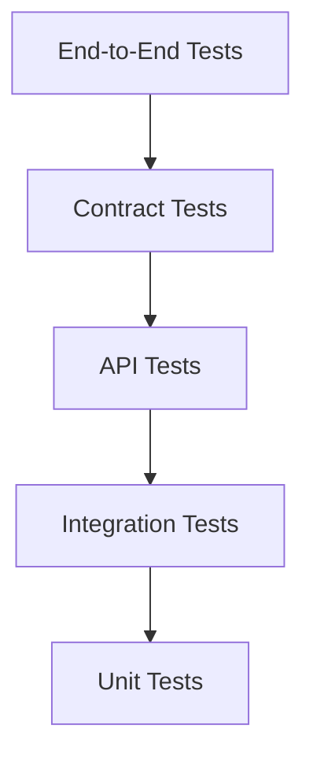
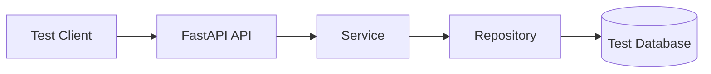

<div align="center">

# 🧪 Testing Strategy

### Unit • API • Contract • Integration • End-to-End

<p>
  
  
  
  
  
</p>

<p>
A layered testing strategy for validating business rules, API contracts,
database behavior, application lifecycle, and production-critical workflows.
</p>

</div>

---

## 📌 1. Purpose

This document defines the testing strategy, directory ownership, fixture rules,
database isolation approach, coverage expectations, naming conventions, and CI
quality gates for the FastAPI microservice foundation.

The test suite should provide confidence that:

* business rules behave correctly,
* API contracts remain stable,
* transactions commit and roll back correctly,
* database integrations work as expected,
* configuration failures are handled safely,
* health endpoints represent application state accurately,
* optional integrations remain disabled without breaking the active service,
* refactoring does not unintentionally change external behavior.

Testing should follow the same architectural boundaries as production code.

---

## 🎯 2. Testing Principles

The project follows these principles:

1. test behavior rather than implementation details,
2. test at the cheapest reliable layer,
3. isolate external infrastructure where possible,
4. use real infrastructure where mocks are insufficient,
5. keep tests deterministic,
6. never depend on test execution order,
7. clean up all resources,
8. make failure output easy to understand,
9. verify transaction rollback explicitly,
10. preserve API compatibility through contract tests.

---

## 🔺 3. Test Pyramid



Recommended distribution:

| Test Layer  | Relative Quantity |          Speed | External Infrastructure      |
| ----------- | ----------------: | -------------: | ---------------------------- |
| Unit        |           Highest |        Fastest | None                         |
| API         |              High |           Fast | Usually mocked or overridden |
| Contract    |          Moderate | Fast to medium | Usually none                 |
| Integration |          Moderate |         Medium | Test database or adapter     |
| End-to-End  |            Lowest |        Slowest | Full test environment        |

The project should contain many fast unit and API tests, fewer integration tests,
and only a small number of end-to-end tests.

---

## 🗂️ 4. Test Structure

```text
tests/
├── api/
│   ├── __init__.py
│   └── test_health.py
├── contract/
│   ├── __init__.py
│   └── test_openapi.py
├── e2e/
│   ├── __init__.py
│   └── test_service.py
├── integration/
│   ├── __init__.py
│   └── test_database.py
├── unit/
│   ├── __init__.py
│   └── test_common.py
├── __init__.py
└── conftest.py
```

Each directory represents a different level of confidence and infrastructure
usage.

---

## ⚡ 5. Unit Tests

Location:

```text
tests/unit/
```

Unit tests validate small pieces of application logic in isolation.

### Suitable Unit Test Targets

* service business rules,
* validation helpers,
* pagination calculations,
* sorting validation,
* filter normalization,
* response metadata,
* custom exceptions,
* configuration normalization,
* utility functions,
* worker route validation,
* Beat schedule validation,
* immutable configuration objects.

### Unit Tests Must Not Require

* a real database,
* Docker,
* network access,
* Redis,
* MongoDB,
* Celery broker,
* external APIs,
* production configuration.

### Example

```python
import pytest

from app.common.exceptions import (
    ResourceConflictError,
)


@pytest.mark.asyncio
async def test_create_product_rejects_duplicate_code() -> None:
    """
    Ensure duplicate product codes are rejected.
    """

    repository = FakeProductRepository(
        existing_code="ABC-100",
    )

    service = ProductService(
        repository=repository,
        uow=FakeUnitOfWork(),
    )

    with pytest.raises(
        ResourceConflictError
    ):
        await service.create_product(
            payload=CreateProductRequest(
                code="ABC-100",
                name="Example",
            )
        )

    assert repository.create_called is False
```

---

## 🌐 6. API Tests

Location:

```text
tests/api/
```

API tests validate HTTP behavior through the FastAPI application.

### Suitable API Test Targets

* status codes,
* response envelopes,
* request validation,
* path parameters,
* query parameters,
* headers,
* middleware behavior,
* health endpoints,
* exception mapping,
* dependency overrides,
* camelCase output.

### Recommended Async Client

```python
from httpx import (
    ASGITransport,
    AsyncClient,
)


async def test_liveness_returns_success(
    app,
) -> None:
    """
    Ensure liveness returns a successful response.
    """

    transport = ASGITransport(
        app=app
    )

    async with AsyncClient(
        transport=transport,
        base_url="http://test",
    ) as client:
        response = await client.get(
            "/health/live"
        )

    assert response.status_code == 200
```

### API Tests Should Verify

* response status,
* response body,
* response headers,
* validation error format,
* external field aliases,
* request ID propagation where relevant.

---

## 📜 7. Contract Tests

Location:

```text
tests/contract/
```

Contract tests protect the externally visible API.

### Suitable Contract Test Targets

* OpenAPI paths,
* operation IDs,
* request schema names,
* response schema names,
* camelCase fields,
* error response structure,
* pagination metadata,
* deprecation markers,
* required headers,
* endpoint removal.

### Example

```python
def test_openapi_contains_liveness_route(
    app,
) -> None:
    """
    Ensure the liveness endpoint remains in the OpenAPI contract.
    """

    schema = app.openapi()

    assert "/health/live" in schema["paths"]
```

### Stable Contract Areas

Treat these as versioned contracts:

```text
URL paths
HTTP methods
operation IDs
request fields
response fields
error codes
pagination structure
```

A contract change should be intentional and reviewed.

---

## 🔗 8. Integration Tests

Location:

```text
tests/integration/
```

Integration tests validate collaboration with concrete infrastructure.

### Suitable Integration Test Targets

* MySQL adapter startup,
* MySQL connectivity,
* repository queries,
* Unit of Work behavior,
* commit,
* rollback,
* connection pool lifecycle,
* readiness checks,
* SQLAlchemy type behavior,
* transaction isolation behavior.

### Real Infrastructure

Repository integration tests should use a real test database whenever query behavior,
joins, indexes, constraints, locking, or dialect-specific behavior matter.

Do not mock SQLAlchemy internals for integration tests.

---

## 🌍 9. End-to-End Tests

Location:

```text
tests/e2e/
```

End-to-end tests validate complete workflows across several layers.



### Suitable End-to-End Scenarios

* create and retrieve a resource,
* complete multi-step business workflow,
* transaction rollback after downstream failure,
* readiness behavior with real infrastructure,
* important security header flow,
* full response contract validation.

Use end-to-end tests sparingly because they are slower and more expensive to maintain.

---

## 🧰 10. Shared Fixtures

Shared fixtures belong in:

```text
tests/conftest.py
```

Recommended fixtures:

* test settings,
* FastAPI application,
* async HTTP client,
* fake repository,
* fake Unit of Work,
* MySQL test session,
* test database cleanup,
* request headers,
* deterministic timestamps,
* deterministic identifiers.

### Fixture Rules

* use the narrowest practical scope,
* clean up all created resources,
* avoid hidden global mutation,
* do not reuse async sessions across unrelated tests,
* do not make all tests depend on one large fixture,
* prefer explicit fixture names,
* keep fixture setup readable.

---

## 🔄 11. Async Test Configuration

Async tests use:

```text
pytest-asyncio
```

Recommended configuration:

```toml
[tool.pytest.ini_options]
asyncio_mode = "auto"
asyncio_default_fixture_loop_scope = "function"
```

### Rules

* use function-scoped event loops,
* await all coroutines,
* close async clients,
* close sessions,
* dispose engines,
* avoid nested event loops,
* avoid `asyncio.run()` inside async tests,
* do not share loop-bound clients across processes.

### Example

```python
import pytest


@pytest.mark.asyncio
async def test_service_returns_product() -> None:
    """
    Ensure the service returns the requested product.
    """

    result = await service.get_product(
        product_id=1,
    )

    assert result.product_id == 1
```

---

## 🧪 12. Arrange, Act, Assert

Tests should generally follow:

```text
Arrange
    ↓
Act
    ↓
Assert
```

### Example

```python
async def test_product_service_returns_not_found() -> None:
    """
    Ensure a missing product raises the expected exception.
    """

    # Arrange
    repository = FakeProductRepository(
        products={},
    )

    service = ProductService(
        repository=repository,
        uow=FakeUnitOfWork(),
    )

    # Act and Assert
    with pytest.raises(
        ResourceNotFoundError
    ):
        await service.get_product(
            product_id=999,
        )
```

The test should make the behavior obvious without reading implementation code.

---

## 🏷️ 13. Test Naming

Use:

```text
test_<expected_behavior>_<condition>
```

Examples:

```text
test_create_product_returns_conflict_when_code_exists
test_get_product_returns_not_found_when_id_is_missing
test_readiness_returns_unavailable_when_mysql_fails
test_pagination_rejects_page_size_above_limit
test_openapi_uses_camel_case_fields
test_uow_rolls_back_when_repository_fails
```

Avoid weak names:

```text
test_product
test_case_1
test_success
test_error
```

---

## 🧭 14. Pytest Markers

Recommended markers:

```text
unit
api
integration
contract
e2e
slow
```

Example:

```python
import pytest


@pytest.mark.integration
@pytest.mark.asyncio
async def test_mysql_connectivity(
    mysql_database,
) -> None:
    """
    Ensure the MySQL adapter can validate connectivity.
    """

    await mysql_database.validate_connectivity()
```

Run only integration tests:

```bash
pytest -m integration
```

Exclude slow tests:

```bash
pytest -m "not slow"
```

---

## ▶️ 15. Running Tests

Run all tests:

```bash
pytest
```

Run one directory:

```bash
pytest tests/unit
pytest tests/api
pytest tests/contract
pytest tests/integration
pytest tests/e2e
```

Run one file:

```bash
pytest tests/api/test_health.py
```

Run one test:

```bash
pytest tests/api/test_health.py::test_liveness_returns_success
```

Verbose output:

```bash
pytest -vv
```

Stop after first failure:

```bash
pytest -x
```

Run the last failed tests:

```bash
pytest --lf
```

Run failed tests first:

```bash
pytest --ff
```

Show local variables on failure:

```bash
pytest --showlocals
```

---

## 📊 16. Coverage

Coverage is configured in:

```text
pyproject.toml
```

Run coverage:

```bash
pytest --cov=app --cov-report=term-missing
```

Generate HTML coverage:

```bash
pytest --cov=app --cov-report=html
```

Generate XML coverage:

```bash
pytest --cov=app --cov-report=xml
```

Open the HTML report:

```text
htmlcov/index.html
```

### Recommended Baseline

```text
80% overall coverage
```

Critical areas should have stronger coverage:

* business validation,
* transaction rollback,
* state transitions,
* error translation,
* configuration validation,
* security-sensitive behavior.

Coverage is a quality signal, not the sole goal.

---

## 🧱 17. Service Unit Tests

Service tests should mock or fake repositories and Unit of Work behavior.

### Verify

* business rules,
* repository coordination,
* exception behavior,
* commit intent,
* no write after failed validation,
* response schema mapping.

### Example Fake Repository

```python
class FakeProductRepository:
    """
    In-memory product repository used by service unit tests.
    """

    def __init__(
        self,
        *,
        products: dict[int, Product] | None = None,
    ) -> None:
        self.products = products or {}
        self.create_called = False

    async def get_by_id(
        self,
        *,
        session: object,
        product_id: int,
    ) -> Product | None:
        return self.products.get(
            product_id
        )
```

Fakes are often clearer than deeply nested mocks.

---

## 🗄️ 18. Repository Integration Tests

Repository tests should verify real persistence behavior.

### Test Areas

* insert behavior,
* update behavior,
* joins,
* optional filters,
* mandatory filters,
* pagination,
* sorting,
* duplicate records,
* row locking,
* null handling,
* date range behavior,
* dialect-specific mappings.

### Example

```python
@pytest.mark.integration
@pytest.mark.asyncio
async def test_repository_filters_by_warehouse(
    session,
) -> None:
    """
    Ensure warehouse filtering returns only matching records.
    """

    repository = ProductRepository()

    result = await repository.list_products(
        session=session,
        warehouse_id=2,
    )

    assert all(
        item.warehouse_id == 2
        for item in result
    )
```

---

## 🔁 19. Transaction Tests

Transaction behavior must be tested explicitly.

### Successful Commit

```text
begin transaction
    ↓
insert parent
    ↓
insert child
    ↓
commit
```

Verify both records persist.

### Rollback

```text
begin transaction
    ↓
insert parent
    ↓
child operation fails
    ↓
rollback
```

Verify neither record persists.

### Example

```python
@pytest.mark.integration
@pytest.mark.asyncio
async def test_uow_rolls_back_all_changes_when_second_operation_fails(
    uow,
    repository,
) -> None:
    """
    Ensure partial writes are not persisted.
    """

    with pytest.raises(
        ExpectedDatabaseError
    ):
        async with uow:
            await repository.create_parent(
                session=uow.session,
            )

            await repository.create_invalid_child(
                session=uow.session,
            )

            await uow.commit()

    assert await repository.count_parents() == 0
```

---

## ❤️ 20. Health Tests

### Liveness Tests

Verify that liveness:

* responds quickly,
* returns success while the application is running,
* does not require database access,
* uses a stable response format.

### Readiness Tests

Verify that readiness:

* succeeds when MySQL is available,
* fails safely when MySQL is unavailable,
* returns the correct status code,
* does not expose connection URLs,
* does not expose raw driver exceptions,
* reports only safe adapter status.

---

## 🛡️ 21. Middleware Tests

Middleware tests should cover:

* request ID generation,
* incoming request ID preservation,
* correlation ID propagation,
* response headers,
* request timing,
* secure headers,
* body size rejection,
* exception correlation,
* trusted proxy handling.

### Example

```python
async def test_request_id_is_added_to_response(
    client,
) -> None:
    """
    Ensure every response contains a request identifier.
    """

    response = await client.get(
        "/health/live"
    )

    assert "X-Request-ID" in response.headers
```

---

## ⚙️ 22. Configuration Tests

Configuration tests should verify:

* valid development settings,
* valid production settings,
* missing MySQL URL when MySQL is enabled,
* disabled optional adapters requiring no URL,
* invalid pool size,
* invalid timeout,
* invalid environment value,
* secret masking,
* safe default behavior.

### Example

```python
def test_mysql_url_is_required_when_mysql_is_enabled() -> None:
    """
    Ensure MySQL cannot be enabled without a connection URL.
    """

    with pytest.raises(
        ValidationError
    ):
        AppSettings(
            ENABLE_MYSQL=True,
            MYSQL_URL=None,
        )
```

---

## 📦 23. Response Contract Tests

Verify the response envelope.

### Success

```json
{
  "success": true,
  "message": "Operation completed successfully",
  "data": {},
  "meta": null
}
```

### Error

```json
{
  "success": false,
  "message": "Operation failed",
  "data": null,
  "error": {
    "code": "APPLICATION_ERROR",
    "details": null
  }
}
```

Contract tests should fail when fields are accidentally renamed or removed.

---

## 🔤 24. Naming Convention Tests

External API fields must remain camelCase.

Python fields remain snake_case.

### Verify

```text
productId
warehouseId
createdAt
pageSize
hasNext
```

Do not expose:

```text
product_id
warehouse_id
created_at
page_size
has_next
```

in external JSON unless explicitly required by an existing contract.

---

## 🧵 25. Worker Tests

Celery is currently disabled.

When worker dependencies are installed, test worker infrastructure without requiring
a real broker where possible.

### Future Unit Tests

* `WorkerConfig` validation,
* queue definition validation,
* task route validation,
* Beat schedule validation,
* signal registration idempotency,
* worker runtime process ownership,
* async event-loop startup,
* event-loop shutdown,
* retry configuration,
* serializable task results.

### Future Integration Tests

* broker publishing,
* task execution,
* retry behavior,
* worker database access,
* Beat schedule publication.

---

## 🎭 26. Mocking Guidelines

Mock:

* external service clients,
* repositories in service unit tests,
* time where deterministic behavior matters,
* ID generation where stable output is needed,
* infrastructure failures.

Do not mock:

* the service being tested,
* Pydantic validation in API tests,
* SQLAlchemy internals in repository integration tests,
* every internal method call,
* simple value objects that can be created directly.

Prefer:

* fakes,
* stubs,
* dependency overrides,
* real test adapters.

---

## 🧪 27. Dependency Overrides

FastAPI dependency overrides should isolate API tests from real infrastructure.

Example:

```python
app.dependency_overrides[
    get_product_service
] = get_fake_product_service
```

Always clean overrides after the test:

```python
app.dependency_overrides.clear()
```

A fixture may handle this automatically.

---

## 🧹 28. Test Cleanup

Every test must clean up its resources.

Close:

* HTTP clients,
* database sessions,
* database engines,
* temporary files,
* event loops,
* mocked patches,
* dependency overrides.

Use:

```python
try:
    ...
finally:
    ...
```

or fixtures with `yield`.

Example:

```python
@pytest.fixture
async def client(
    app,
):
    transport = ASGITransport(
        app=app
    )

    async with AsyncClient(
        transport=transport,
        base_url="http://test",
    ) as test_client:
        yield test_client
```

---

## 🗃️ 29. Test Database Isolation

Integration tests must never use:

* production databases,
* shared staging databases,
* another developer's schema,
* live customer data.

Recommended strategies:

1. dedicated test database,
2. transaction rollback per test,
3. temporary schema,
4. ephemeral infrastructure,
5. isolated test tenant.

### Preferred Rule

```text
One test
    =
One isolated transaction or dataset
```

---

## 🔒 30. Test Data Safety

Do not use:

* real patient data,
* production product data,
* private prescription details,
* real email addresses,
* real phone numbers,
* production credentials,
* real access tokens.

Use synthetic values:

```text
test@example.com
TEST-PRODUCT-001
warehouse_id=999
```

---

## 🧰 31. Test Data Builders

Prefer small builders or factories.

```python
def build_product(
    *,
    product_id: int = 1,
    product_name: str = "Example Product",
    warehouse_id: int = 2,
) -> Product:
    """
    Build a product test object.
    """

    return Product(
        id=product_id,
        product_name=product_name,
        warehouse_id=warehouse_id,
    )
```

Benefits:

* readable defaults,
* explicit overrides,
* less duplicated setup,
* easier maintenance.

Avoid giant global fixture dictionaries.

---

## ⏱️ 32. Time-Dependent Tests

Time-dependent tests should be deterministic.

Prefer:

* injecting a clock,
* using fixed timestamps,
* using a time-freezing library when enabled.

Example:

```python
fixed_time = datetime(
    2026,
    8,
    6,
    10,
    0,
    tzinfo=timezone.utc,
)
```

Avoid assertions based on the current system clock without tolerance.

---

## 🆔 33. Identifier Tests

Generated IDs should be deterministic when required by assertions.

Use dependency injection or patched generators.

Example:

```python
EXPECTED_REQUEST_ID = "test-request-id"
```

Do not assert random values exactly unless the generator is controlled.

---

## 📋 34. Parametrized Tests

Use parametrization for repeated business cases.

```python
@pytest.mark.parametrize(
    (
        "page",
        "page_size",
        "is_valid",
    ),
    [
        (1, 20, True),
        (0, 20, False),
        (1, 0, False),
        (1, 1000, False),
    ],
)
def test_pagination_validation(
    page: int,
    page_size: int,
    is_valid: bool,
) -> None:
    """
    Validate pagination boundaries.
    """
```

Parametrization improves coverage without duplicating test functions.

---

## 🚫 35. Avoid Test Order Dependencies

Tests must pass when run:

```bash
pytest
pytest --random-order
pytest tests/unit/test_common.py
pytest tests/unit/test_common.py::test_specific_case
```

A test should not depend on another test creating state first.

Bad:

```text
test_create_product
    must run before
test_get_product
```

Each test prepares its own required state.

---

## 🧯 36. Failure Testing

Do not test only successful paths.

Test:

* missing records,
* duplicate values,
* invalid states,
* database failures,
* timeouts,
* transaction rollback,
* invalid configuration,
* unsupported sort fields,
* oversized requests,
* missing trusted headers,
* external service failures.

Production failures often occur in these paths.

---

## 🧾 37. Assertion Guidelines

Use focused assertions.

Good:

```python
assert response.status_code == 404
assert body["error"]["code"] == "RESOURCE_NOT_FOUND"
```

Avoid one broad assertion on a huge object when smaller assertions explain failure
better.

For complete contract snapshots, use them intentionally and review changes carefully.

---

## 📜 38. Log Testing

Test logging only when logging behavior is important.

Suitable cases:

* secrets are redacted,
* request IDs are attached,
* exceptions are logged,
* lifecycle logs occur,
* no raw database URL is emitted.

Avoid asserting complete formatted log lines unless exact format is a contract.

---

## ⚡ 39. Performance Tests

Performance tests are not part of the default pytest suite unless explicitly marked.

Possible future tools:

* Locust,
* k6,
* JMeter,
* custom async load scripts.

Suitable targets:

* list endpoints,
* large pagination,
* bulk operations,
* database pool pressure,
* health endpoints,
* concurrent writes.

Performance tests should use a controlled environment and known dataset.

---

## 🔐 40. Security Tests

Recommended security-focused tests:

* request size limits,
* header spoofing behavior,
* CORS configuration,
* secure response headers,
* invalid query values,
* injection attempts,
* error message sanitization,
* secret redaction,
* disabled documentation in production when configured.

Do not rely only on static analysis.

---

## 🧪 41. Optional Advanced Testing Tools

These tools may be enabled later.

### Property-Based Testing

```text
hypothesis
```

Useful for:

* filters,
* serializers,
* pagination,
* boundary values,
* validation logic.

### Time Freezing

```text
freezegun
```

Useful for:

* expiry rules,
* scheduled operations,
* date-based state changes.

### Parallel Execution

```text
pytest-xdist
```

Useful when:

* tests are isolated,
* the suite is large,
* CI resources support concurrency.

### Timeout Enforcement

```text
pytest-timeout
```

Useful for:

* detecting blocked async tests,
* preventing stuck CI jobs.

### Random Test Ordering

```text
pytest-randomly
```

Useful for detecting hidden state leakage.

---

## 🔄 42. CI Test Pipeline

Recommended order:


Fast failures should occur before expensive integration or Docker stages.

---

## 🚦 43. Quality Gates

A pull request should fail when:

* formatting is incorrect,
* Ruff reports errors,
* mypy reports errors,
* unit tests fail,
* API tests fail,
* contract tests fail,
* integration tests fail,
* coverage falls below the agreed threshold,
* a critical dependency vulnerability is found,
* Docker image build fails.

Quality gates should be automated in CI.

---

## 📈 44. Coverage Expectations by Layer

| Layer                 | Recommended Focus                     |
| --------------------- | ------------------------------------- |
| Common utilities      | High                                  |
| Business services     | Very high                             |
| Transaction logic     | Very high                             |
| Repositories          | Important query paths                 |
| API routes            | Success and failure contracts         |
| Middleware            | Critical cross-cutting behavior       |
| Configuration         | All validation paths                  |
| Worker infrastructure | Validation and lifecycle when enabled |
| Simple declarations   | Lower priority                        |

Do not chase 100% coverage for files with little executable behavior.

---

## 🧭 45. Test Review Checklist

Before merging:

* [ ] new business rules have unit tests,
* [ ] API routes have success tests,
* [ ] API routes have failure tests,
* [ ] validation errors use the standard response,
* [ ] transaction rollback is tested,
* [ ] repositories have integration coverage,
* [ ] OpenAPI changes are intentional,
* [ ] camelCase fields are verified,
* [ ] no tests use production credentials,
* [ ] async resources close cleanly,
* [ ] tests do not depend on execution order,
* [ ] tests are deterministic,
* [ ] no unnecessary sleeps are used,
* [ ] coverage remains above the threshold,
* [ ] CI passes.

---

## 🚫 46. Common Testing Mistakes

### Mocking Everything

This can make tests pass while real integration is broken.

### Using a Shared Development Database

Tests may modify data unexpectedly and become non-deterministic.

### Testing Private Method Calls

Test public behavior instead.

### Using `sleep()` for Synchronization

Use events, awaits, or deterministic hooks.

### Reusing Sessions Across Tests

This causes leaked state and event-loop issues.

### Ignoring Rollback

A workflow may leave partial data even though success tests pass.

### Testing Only Happy Paths

Failure paths are critical in production.

### Large Fixture Trees

Tests become hard to understand and maintain.

---

## 🧹 47. Cleaning Test Artifacts

Remove coverage output:

### Linux or macOS

```bash
rm -rf htmlcov
rm -f .coverage coverage.xml
```

### Windows PowerShell

```powershell
Remove-Item htmlcov -Recurse -Force -ErrorAction SilentlyContinue
Remove-Item .coverage -Force -ErrorAction SilentlyContinue
Remove-Item coverage.xml -Force -ErrorAction SilentlyContinue
```

Remove pytest cache:

```bash
rm -rf .pytest_cache
```

PowerShell:

```powershell
Remove-Item .pytest_cache -Recurse -Force -ErrorAction SilentlyContinue
```

---

## 📋 48. Common Test Commands

```bash
# Run all tests
pytest

# Run unit tests
pytest tests/unit

# Run API tests
pytest tests/api

# Run contract tests
pytest tests/contract

# Run integration tests
pytest tests/integration

# Run end-to-end tests
pytest tests/e2e

# Run one file
pytest tests/api/test_health.py

# Run one test
pytest tests/api/test_health.py::test_liveness_returns_success

# Verbose output
pytest -vv

# Stop after first failure
pytest -x

# Run last failures
pytest --lf

# Exclude slow tests
pytest -m "not slow"

# Run coverage
pytest --cov=app --cov-report=term-missing

# Generate HTML coverage
pytest --cov=app --cov-report=html

# Generate XML coverage
pytest --cov=app --cov-report=xml
```

---

## 📚 49. Related Documentation

| Document          | Purpose                            |
| ----------------- | ---------------------------------- |
| `README.md`       | Project overview and quick start   |
| `ARCHITECTURE.md` | Architecture and runtime design    |
| `STRUCTURE.md`    | Folder and file responsibilities   |
| `DEVELOPMENT.md`  | Local development workflow         |
| `TESTING.md`      | Testing strategy and quality gates |

---

<div align="center">

## 💡 Testing Principle

**Test behavior at the cheapest reliable layer.**

</div>
